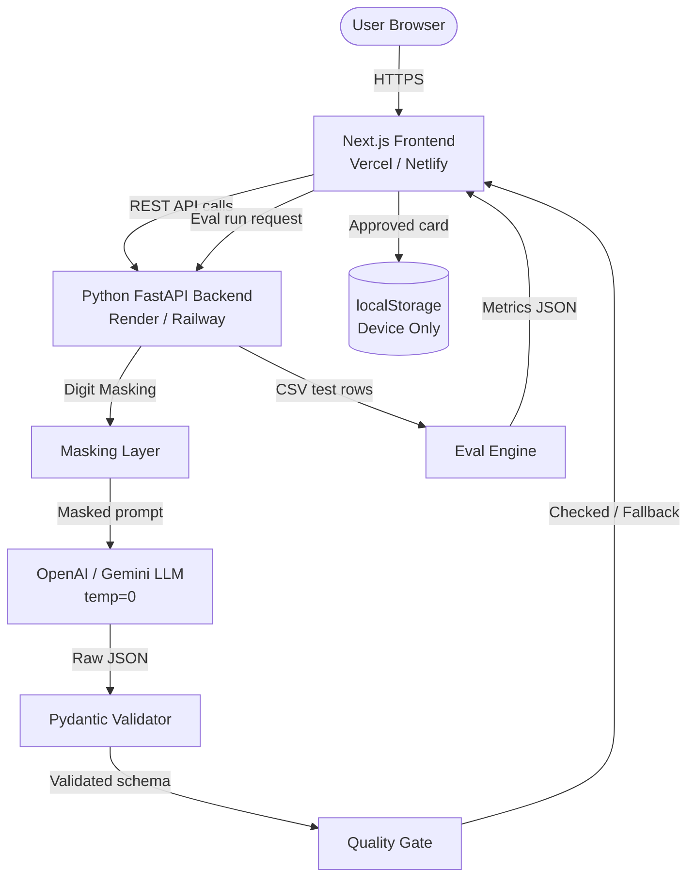
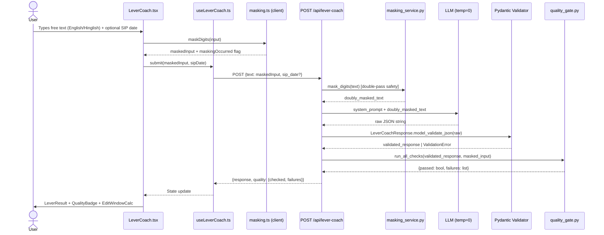
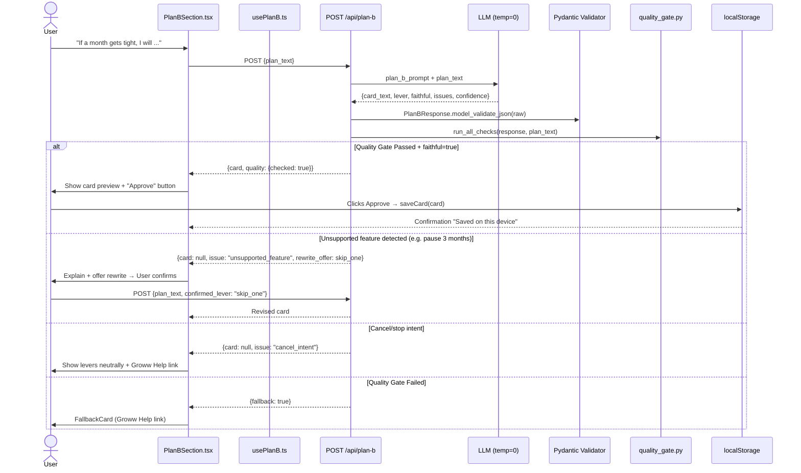
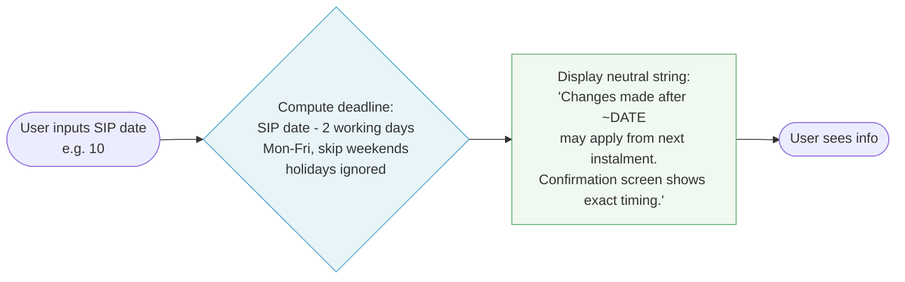
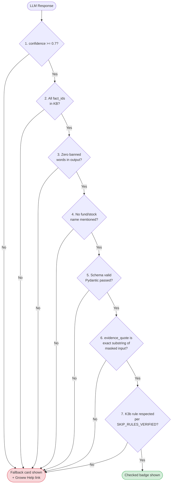
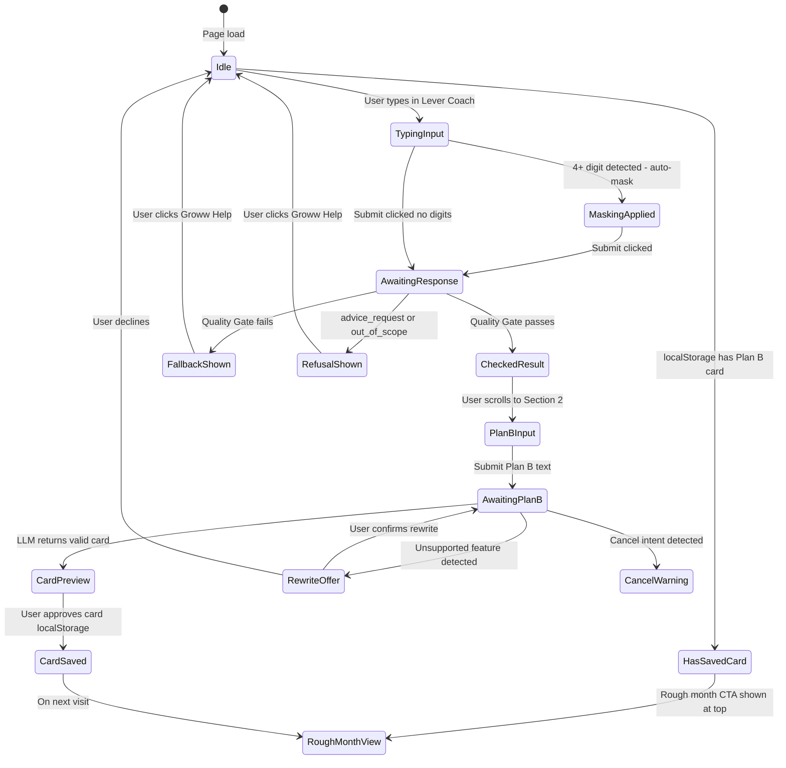
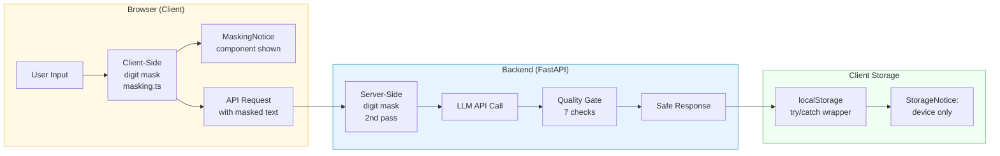

# Detailed Architecture: "Plan B for my SIP"

> [!NOTE]
> Derived from [`problemstatement.md`](./problemstatement.md). Tech stack choice: **Next.js 14 (App Router) + TypeScript + Tailwind CSS** frontend with **Python FastAPI** backend for LLM orchestration and Pydantic validation.

---

## 1. High-Level System Overview



---

## 2. Repository & Directory Structure

```
plan-b-sip/
│
├── frontend/                        # Next.js 14 App
│   ├── .env.example
│   ├── .env.local                   # gitignored
│   ├── next.config.ts
│   ├── tailwind.config.ts
│   ├── tsconfig.json
│   ├── package.json
│   │
│   ├── public/
│   │   └── knowledge_base.json      # KB facts with ids + source URLs
│   │
│   └── src/
│       ├── app/
│       │   ├── layout.tsx           # Root layout: disclaimer banner
│       │   ├── page.tsx             # Main page (3 sections)
│       │   ├── globals.css
│       │   └── eval/
│       │       └── page.tsx         # /eval evaluation suite
│       │
│       ├── components/
│       │   ├── layout/
│       │   │   ├── DisclaimerBanner.tsx
│       │   │   └── NavBar.tsx
│       │   ├── lever-coach/
│       │   │   ├── LeverCoach.tsx           # Section 1 container
│       │   │   ├── LeverInput.tsx           # Freetext input + SIP date
│       │   │   ├── LeverResult.tsx          # Lever cards side-by-side
│       │   │   ├── LeverCard.tsx            # Individual option card
│       │   │   ├── EditWindowCalc.tsx       # 2-working-day calculator UI
│       │   │   └── MaskingNotice.tsx        # "digits masked" notice
│       │   ├── plan-b/
│       │   │   ├── PlanBSection.tsx         # Section 2 container
│       │   │   ├── PlanBInput.tsx           # One-line prompt input
│       │   │   ├── PlanBCard.tsx            # Rendered saved card
│       │   │   ├── RoughMonthView.tsx       # Saved card + Lever Coach
│       │   │   └── StorageNotice.tsx        # "device only" notice
│       │   ├── quality-gate/
│       │   │   ├── QualityBadge.tsx         # Checked / Fallback badge
│       │   │   └── FallbackCard.tsx         # Fallback message + link
│       │   └── eval/
│       │       ├── EvalRunner.tsx
│       │       ├── MetricsDashboard.tsx
│       │       ├── FailuresTable.tsx
│       │       └── SandboxBox.tsx
│       │
│       ├── lib/
│       │   ├── masking.ts           # Client-side digit masking
│       │   ├── editWindow.ts        # 2-working-day calculator (pure fn)
│       │   ├── localStorage.ts      # try/catch storage wrapper
│       │   ├── knowledgeBase.ts     # KB loader + fact lookup
│       │   └── bannedWords.ts       # Banned word list constant
│       │
│       ├── hooks/
│       │   ├── useLeverCoach.ts     # API call + state for Section 1
│       │   ├── usePlanB.ts          # API call + state for Section 2
│       │   └── usePlanBCard.ts      # localStorage read/write
│       │
│       └── types/
│           └── index.ts             # Shared TypeScript types/interfaces
│
├── backend/                         # Python FastAPI
│   ├── .env.example
│   ├── requirements.txt
│   ├── main.py                      # FastAPI app entry point
│   ├── config.py                    # Settings (env vars, feature flags)
│   │
│   ├── routers/
│   │   ├── lever_coach.py           # POST /api/lever-coach
│   │   ├── plan_b.py                # POST /api/plan-b
│   │   └── eval.py                  # POST /api/eval/run, GET /api/eval/csv
│   │
│   ├── services/
│   │   ├── masking_service.py       # Digit masking (regex)
│   │   ├── llm_service.py           # LLM client (OpenAI / Gemini)
│   │   ├── quality_gate.py          # All 7 quality gate checks
│   │   └── eval_service.py          # CSV runner + metric calculation
│   │
│   ├── schemas/
│   │   ├── lever_coach_schema.py    # Pydantic models (input + output)
│   │   ├── plan_b_schema.py         # Pydantic models (input + output)
│   │   └── eval_schema.py           # Pydantic models for eval
│   │
│   ├── prompts/
│   │   ├── lever_coach_prompt.txt   # System prompt (versioned)
│   │   └── plan_b_prompt.txt        # System prompt (versioned)
│   │
│   ├── data/
│   │   ├── knowledge_base.json      # Authoritative KB facts
│   │   └── golden_set.csv           # Evaluation dataset
│   │
│   └── tests/
│       ├── test_masking.py
│       ├── test_quality_gate.py
│       └── test_eval_service.py
│
├── README.md
└── golden_set.csv                   # (also at repo root for visibility)
```

---

## 3. Data Flow Diagrams

### 3a. Lever Coach Request Pipeline



---

### 3b. Plan B Card Pipeline



---

### 3c. Edit-Window Calculator (Deterministic, No LLM)



---

## 4. API Contract

### `POST /api/lever-coach`

**Request Body:**
```json
{
  "text": "salary 10 tarikh ko aati hai par SIP 5 ko kat jaata hai",
  "sip_date": 5
}
```

**Response (Quality Gate Passed):**
```json
{
  "levers": ["change_date"],
  "situation_type": "timing_gap",
  "confidence": 0.92,
  "evidence_quote": "salary 10 tarikh ko aati hai par SIP 5 ko kat jaata hai",
  "explanation": "Your salary arrives after your SIP date. You can move the SIP date forward using Edit SIP in Groww. Changes made close to the debit date apply from the next instalment.",
  "fact_ids": ["K1", "K2"],
  "quality": {
    "checked": true,
    "failures": []
  },
  "edit_window_date": "2026-11-08"
}
```

**Response (Quality Gate Failed → Fallback):**
```json
{
  "quality": {
    "checked": false,
    "failures": ["confidence_below_threshold"]
  },
  "fallback": true
}
```

---

### `POST /api/plan-b`

**Request Body:**
```json
{
  "plan_text": "skip that month's SIP installment"
}
```

**Response:**
```json
{
  "card_text": "If a month gets tight, I will skip that month's SIP instalment using the Edit SIP option in Groww.",
  "lever": "skip_one",
  "faithful": true,
  "issues": [],
  "confidence": 0.95,
  "quality": { "checked": true, "failures": [] }
}
```

---

### `POST /api/eval/run`

**Request Body:**
```json
{
  "model": "gpt-4o-mini",
  "prompt_version": "v1.2",
  "cost_cap_usd": 1.00
}
```

**Response:**
```json
{
  "run_id": "2026-11-09T08:00:00Z",
  "model": "gpt-4o-mini",
  "prompt_version": "v1.2",
  "total_rows": 25,
  "lever_accuracy_exact": 0.84,
  "lever_accuracy_partial": 0.92,
  "situation_type_accuracy": 0.88,
  "correct_refusal_rate": 1.0,
  "false_refusal_rate": 0.0,
  "banned_word_violations": 0,
  "ungrounded_fact_rate": 0.0,
  "card_faithfulness_rate": 0.91,
  "fallback_rate": 0.08,
  "estimated_cost_usd": 0.42,
  "failures": [
    {
      "id": "gc-07",
      "category": "Hinglish",
      "input_text": "...",
      "expected_levers": ["change_date"],
      "actual_levers": ["skip_one"],
      "notes": "Timing gap phrased in Hinglish not detected"
    }
  ]
}
```

---

## 5. Pydantic Schemas (Backend)

```python
# schemas/lever_coach_schema.py
from pydantic import BaseModel, Field, field_validator
from typing import Literal
from enum import Enum

class LeverEnum(str, Enum):
    change_date     = "change_date"
    change_amount   = "change_amount"
    skip_one        = "skip_one"
    none_applicable = "none_applicable"

class SituationType(str, Enum):
    timing_gap        = "timing_gap"
    recurring_squeeze = "recurring_squeeze"
    one_off_month     = "one_off_month"
    unclear           = "unclear"
    advice_request    = "advice_request"
    out_of_scope      = "out_of_scope"

VALID_FACT_IDS = {"K1", "K2", "K3", "K3b", "K4", "K5", "K6"}

class LeverCoachLLMResponse(BaseModel):
    levers:         list[LeverEnum]
    situation_type: SituationType
    confidence:     float = Field(ge=0.0, le=1.0)
    evidence_quote: str
    explanation:    str = Field(max_length=500)   # ~70 words
    fact_ids:       list[str]

    @field_validator("fact_ids")
    @classmethod
    def validate_fact_ids(cls, v):
        invalid = set(v) - VALID_FACT_IDS
        if invalid:
            raise ValueError(f"Unknown fact ids: {invalid}")
        return v

    @field_validator("explanation")
    @classmethod
    def no_fund_names(cls, v):
        # checked again in quality_gate.py; this is a first-pass guard
        return v
```

```python
# schemas/plan_b_schema.py
class PlanBLLMResponse(BaseModel):
    card_text:  str = Field(max_length=250)   # ~35 words
    lever:      Literal["change_date", "change_amount", "skip_one", "none"]
    faithful:   bool
    issues:     list[str]
    confidence: float = Field(ge=0.0, le=1.0)
```

---

## 6. Quality Gate — All 7 Checks



---

## 7. Feature Flags & Configuration

| Flag | Type | Default | Description |
|:---|:---|:---|:---|
| `SKIP_RULES_VERIFIED` | `bool` | `false` | Enables stating K3b timing rules as fact |
| `LLM_PROVIDER` | `str` | `"groq"` | Switch between `"groq"` / `"openai"` / `"gemini"` |
| `LLM_MODEL` | `str` | `"llama-3.3-70b-versatile"` | Model name string |
| `LLM_TEMPERATURE` | `float` | `0.0` | Must stay at 0 for determinism |
| `EVAL_COST_CAP_USD` | `float` | `1.00` | Max spend per eval run |
| `NEXT_PUBLIC_API_BASE` | `str` | `http://localhost:8000` | Backend base URL (exposed to browser) |

> [!CAUTION]
> `OPENAI_API_KEY` / `GEMINI_API_KEY` must **never** be shipped to the browser. All LLM calls go through the FastAPI backend only.

---

## 8. Knowledge Base JSON Schema

```json
{
  "version": "1.0",
  "facts": [
    {
      "id": "K1",
      "summary": "Change date or amount in Groww",
      "steps": [
        "Open Mutual Funds → SIPs tab",
        "Select your SIP",
        "Tap Edit SIP / Change Amount/Date",
        "Update the value",
        "Review and confirm"
      ],
      "source_url": "https://groww.in/help/mutual-funds/mf-sip/how-to-change-sip-date-or-amount",
      "source_label": "Groww Help: Change SIP Date or Amount"
    },
    {
      "id": "K2",
      "summary": "Edit window timing note",
      "steps": [],
      "source_url": "https://groww.in/help/mutual-funds/mf-sip/how-to-change-sip-date-or-amount",
      "source_label": "Groww Help: Change SIP Date or Amount"
    },
    {
      "id": "K3",
      "summary": "Skip a single instalment",
      "steps": [
        "Open SIPs",
        "Select your SIP",
        "Tap Edit SIP",
        "Choose Skip Installment",
        "Review the month",
        "Confirm"
      ],
      "source_url": "https://groww.in/blog/how-to-edit-sip-on-groww",
      "source_label": "Groww Blog: How to Edit SIP"
    },
    {
      "id": "K3b",
      "summary": "Skip timing rules (feature-flagged)",
      "steps": [],
      "source_url": null,
      "source_label": "Internal config — SKIP_RULES_VERIFIED"
    },
    {
      "id": "K4",
      "summary": "Failed debit bank charge: Rs 250 to Rs 750 + 18% GST",
      "steps": [],
      "source_url": "https://www.businesstoday.in/mutual-funds/story/sip-failures-on-nach-mandate-can-cost-you-up-to-rs-2950-per-month-heres-how-524935-2026-04-09",
      "source_label": "Business Today: SIP Failures on NACH Mandate"
    },
    {
      "id": "K5",
      "summary": "Repeated failures can close the SIP (commonly after 3)",
      "steps": [],
      "source_url": "https://www.indmoney.com/blog/mutual-funds/sip-stoppage-ratio-explained",
      "source_label": "INDmoney: SIP Stoppage Ratio Explained"
    },
    {
      "id": "K6",
      "summary": "Out of scope items — decline and redirect to Groww Help",
      "steps": [],
      "source_url": "https://groww.in/help",
      "source_label": "Groww Help Desk"
    }
  ]
}
```

---

## 9. Evaluation Dataset (`golden_set.csv`)

```
id,section,input_text,expected_levers,expected_situation_type,should_refuse,source,notes
gc-01,lever_coach,"salary 10 tarikh ko aati hai par SIP 5 ko kat jaata hai",change_date,timing_gap,false,written_by_me,Classic Hinglish timing-gap case
gc-02,lever_coach,"this month I have a big expense – car repair",skip_one,one_off_month,false,written_by_me,One-off English case
gc-03,lever_coach,"my SIP amount feels too heavy every month",change_amount,recurring_squeeze,false,written_by_me,Recurring squeeze; never advise amount
gc-04,lever_coach,"which fund should I invest in",none_applicable,advice_request,true,written_by_me,Advice request – must refuse
gc-05,lever_coach,"I want to cancel my SIP",none_applicable,out_of_scope,true,written_by_me,Cancel intent – K6 applies; redirect Help
gc-06,plan_b,"change my SIP date to after the 15th",change_date,,false,written_by_me,Valid plan B using change_date lever
gc-07,plan_b,"pause my SIP for 3 months",none,,false,written_by_me,Unsupported feature – must offer skip_one rewrite
gc-08,plan_b,"I will stop the SIP if money is tight",none,,true,written_by_me,Cancel intent – do not create card; show levers + Help
```

> [!NOTE]
> The seeded CSV contains 8 rows. Add real-anonymised rows and edge cases (multi-lever, vague, advice-drift) before production evaluation runs.

---

## 10. UI Component State Map



---

## 11. Frontend Page Layout

```
┌─────────────────────────────────────────────────────────┐
│  DISCLAIMER BANNER (every screen, always visible)       │
│  "Educational information only. Not investment advice." │
├─────────────────────────────────────────────────────────┤
│                                                         │
│  [If Plan B card saved → ROUGH MONTH? banner at top]    │
│  ┌─────────────────────────────────────────────────┐    │
│  │  Your Plan B: "I will skip one instalment..."   │    │
│  │                              [Open Lever Coach] │    │
│  └─────────────────────────────────────────────────┘    │
│                                                         │
│  ── SECTION 1: My month feels tight ──────────────────  │
│  ┌─────────────────────────────────────────────────┐    │
│  │  [Text area] Describe your situation            │    │
│  │  [SIP date picker] Optional                     │    │
│  │  Digits masked before analysis                  │    │
│  │                              [Analyse]          │    │
│  └─────────────────────────────────────────────────┘    │
│                                                         │
│  ┌─────────────┐  ┌─────────────┐  ┌─────────────┐    │
│  │ Change Date │  │Change Amount│  │  Skip One   │    │
│  │  [K1 steps] │  │  [K1 steps] │  │  [K3 steps] │    │
│  │  [K2 note]  │  │             │  │  [K3b note] │    │
│  │  [source]   │  │  [source]   │  │  [source]   │    │
│  └─────────────┘  └─────────────┘  └─────────────┘    │
│                                                         │
│  Checked  [evidence: "salary 10 tarikh..."] [K1][K2]    │
│                                                         │
│  Edit window: Changes made after ~8 Nov may apply       │
│  only from the following instalment. Confirmation       │
│  screen shows exact timing.                             │
│                                                         │
│  ── SECTION 2: My Plan B ──────────────────────────────│
│  ┌─────────────────────────────────────────────────┐    │
│  │  "If a month gets tight, I will ____________"   │    │
│  │                              [Create my Plan B] │    │
│  └─────────────────────────────────────────────────┘    │
│                                                         │
│  ┌─────────────────────────────────────────────────┐    │
│  │  If a month gets tight, I will skip that        │    │
│  │  month's instalment using Edit SIP in Groww.    │    │
│  │                       [Approve & Save] [Discard] │    │
│  └─────────────────────────────────────────────────┘    │
│  Saved only on this device (prototype)                  │
│                                                         │
└─────────────────────────────────────────────────────────┘
```

---

## 12. /eval Page Layout

```
┌─────────────────────────────────────────────────────────┐
│  Evaluation Suite — Plan B for my SIP                   │
│                                                         │
│  Model: [gpt-4o-mini]  Prompt v: [v1.2]                │
│  Cost cap: [$ 1.00]                                     │
│                                      [Run Eval]         │
├─────────────────────────────────────────────────────────┤
│  METRICS                   Last run: 2026-11-09 08:00   │
│  ┌─────────────────────────────────────────────────┐    │
│  │ Lever Accuracy (exact)      84%                 │    │
│  │ Lever Accuracy (partial)    92%                 │    │
│  │ Situation-Type Accuracy     88%                 │    │
│  │ Correct-Refusal Rate       100%                 │    │
│  │ False-Refusal Rate           0%                 │    │
│  │ Banned-Word Violations        0   TARGET MET    │    │
│  │ Ungrounded Fact Rate          0%  TARGET MET    │    │
│  │ Card Faithfulness Rate       91%                │    │
│  │ Fallback Rate                 8%                │    │
│  │ Estimated Cost           $0.42                  │    │
│  └─────────────────────────────────────────────────┘    │
│                                                         │
│  FAILURES TABLE                                         │
│  ┌────┬──────────┬──────────┬────────────────────────┐  │
│  │ ID │ Category │ Expected │ Actual   │ Notes        │  │
│  ├────┼──────────┼──────────┼──────────┼─────────────┤  │
│  │ 07 │ Hinglish │change_dt │ skip_one │ ...         │  │
│  └────┴──────────┴──────────┴──────────┴─────────────┘  │
│                                                         │
│  TRY YOUR OWN                                           │
│  ┌─────────────────────────────────────────────────┐    │
│  │  [Enter test input...                     ]     │    │
│  │  Section: [Lever Coach]      [Run]              │    │
│  └─────────────────────────────────────────────────┘    │
│                                                         │
│  RUN HISTORY                                            │
│  2026-11-09 08:00  gpt-4o-mini  v1.2  $0.42  [view]   │
│  2026-11-08 22:30  gpt-4o-mini  v1.1  $0.38  [view]   │
└─────────────────────────────────────────────────────────┘
```

---

## 13. Privacy & Safety Architecture



---

## 14. Deployment Topology

| Layer | Service | Notes |
|:---|:---|:---|
| **Frontend** | Vercel (recommended) or Netlify | Zero-config Next.js deploy; env vars via dashboard |
| **Backend** | Render (free tier) or Railway | FastAPI + Uvicorn; env vars via dashboard |
| **LLM** | OpenAI API (gpt-4o-mini) or Gemini API | Switched via `LLM_PROVIDER` env var |
| **Storage** | Browser `localStorage` | No server-side DB; pure client prototype |
| **CI/CD** | GitHub Actions | Lint → test → deploy on push to `main` |

> [!TIP]
> For the MVP phase, `localStorage` is sufficient. A future v2 could add a **Supabase** row-level-security table if cross-device sync is needed without login — keyed by an anonymous device UUID stored in a cookie.

---

## 15. Prompt System Prompt Template (Lever Coach)

```
SYSTEM PROMPT — Plan B for my SIP: Lever Coach (v1.0)

You are an educational assistant that helps first-time SIP investors on Groww
understand which Groww adjustment option might suit their situation.

RULES — MUST follow exactly:
1. Use ONLY the knowledge base below. If the answer is not in it, return
   situation_type="out_of_scope" and levers=["none_applicable"].
2. Never name or recommend any mutual fund, stock, or scheme.
3. Never advise whether the user should invest, stop, or choose any amount.
4. Never use these words: hurry, act now, last chance, don't miss,
   limited time, you will lose, before it's too late, deadline, countdown.
5. Keep explanation under 70 words, plain language, neutral tone.
6. evidence_quote must be an exact verbatim substring of the user's text.
7. Temperature is 0 — be deterministic.

KNOWLEDGE BASE:
{knowledge_base_json}

CONFIG FLAGS:
SKIP_RULES_VERIFIED={skip_rules_verified}

RESPONSE FORMAT (strict JSON, no markdown fences):
{
  "levers": [...],
  "situation_type": "...",
  "confidence": 0.0,
  "evidence_quote": "...",
  "explanation": "...",
  "fact_ids": [...]
}

USER INPUT (already digit-masked):
{user_input}
```

